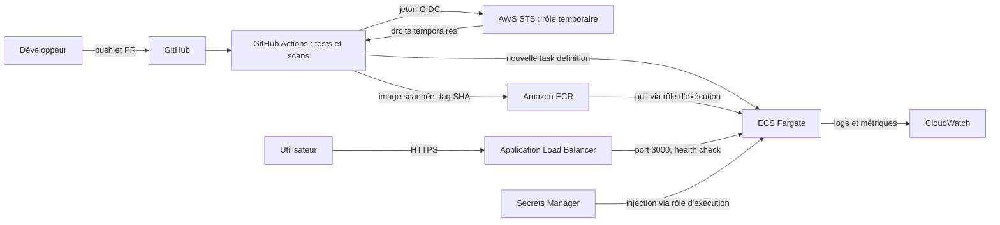

# devsecops-tp

[](https://github.com/Eladji/devsecops-tp/actions/workflows/ci.yml)
[](https://github.com/Eladji/devsecops-tp/actions/workflows/codeql.yml)

API Node.js du TP « Rends ce repo prêt pour la prod ». Les liens GitHub ciblent
`Eladji/devsecops-tp` ; adapter le propriétaire si le dépôt est publié ailleurs.
Les badges afficheront les résultats après publication et exécution des workflows.

## Démarrage

Prérequis : Node.js 22 et npm. `ping` doit être disponible pour `/ping`
(présent dans l'image Alpine fournie).

```sh
npm ci
npm test -- --runInBand
npm start
curl http://localhost:3000/health
```

Le port par défaut est 3000. `.env.example` documente `PORT=3000` ; pour changer
le port, utiliser par exemple `PORT=3001 npm start` (pas de chargement automatique de `.env`).

| Route | Comportement |
| --- | --- |
| `GET /health` | `{"status":"ok"}` |
| `GET /hello?name=Lina` | Message HTML avec nom échappé, 256 caractères maximum |
| `GET /ping?host=example.com` | Un ping, hôte DNS ou IP validé ; délai de 5 s ; erreur réseau : 502 |
| `GET /prefs?theme=dark&lang=en` | Uniquement `theme=light\|dark` et `lang=fr\|en`, valeurs par défaut `light/fr` |

Les hôtes structurés ou répétés, les noms répétés et les préférences non conformes
sont refusés. Une préférence inconnue est refusée avec un statut 400.

## Sécurité & coûts

### Secrets

`.gitignore` exclut `node_modules/`, `.env`, les variantes de `.env`, `coverage/`
et `*.log`. `.env.example` ne contient qu'un port. `.dockerignore` exclut aussi
les secrets, l'historique Git, les tests et les rapports du contexte Docker.

**Une clé AWS poussée puis supprimée reste compromise.** Elle existe encore
dans l'historique, les clones, les forks et éventuellement les journaux.

1. Désactiver/révoquer immédiatement la clé exposée auprès d'AWS. Ne pas attendre le nettoyage Git.
2. Examiner CloudTrail, les accès, les changements IAM, les ressources créées et la facturation depuis la fuite ; alerter le responsable sécurité.
3. Remplacer les accès nécessaires par OIDC ou un rôle temporaire ; si une nouvelle clé est indispensable, la créer avec des droits minimaux et la distribuer via un gestionnaire de secrets.
4. Nettoyer l'historique avec `git filter-repo`, coordonner la réécriture des références et le renouvellement des clones, puis faire supprimer les copies accessibles quand c'est possible. Cette opération ne rend jamais l'ancienne clé sûre.
5. Activer/vérifier Secret Protection et Push protection et rechercher d'autres secrets exposés.

Les réglages GitHub et leur capture restent à effectuer après publication ; voir
la liste de validation à la fin. Aucune capture ni activation distante n'est simulée.

### Dépendances : mesures avant / après

Mesures réelles du **4 novembre 2026**, conservées dans `reports/npm-audit-*.json`.
Les nombres incluent les dépendances directes et transitives, y compris de développement.

| Audit | Critical | High | Moderate | Low |
| --- | ---: | ---: | ---: | ---: |
| Avant | 0 | 5 | 16 | 7 |
| Après | 0 | 0 | 16 | 3 |
| Après, production uniquement (`--omit=dev`) | 0 | 0 | 0 | 0 |

Express passe de **4.17.1 à 4.22.3**, Lodash de **4.17.15 à 4.18.1**.
Jest est mis à jour en **30.5.2** et Supertest en **7.3.1** ; le lockfile est versionné.
Les **19 alertes restantes sont dans l'outillage de développement**, notamment
les chaînes `deepmerge`, `glob` et `minimatch` de Jest. Elles restent documentées ;
la suggestion automatique de rétrograder Jest en 25 n'est pas appliquée.
Le seuil demandé `npm audit --audit-level=high` passe (code de sortie 0),
et l'audit des dépendances de production est vide.

Dependabot surveille chaque semaine les trois écosystèmes `npm`, `github-actions`
et `docker`. Les alertes et mises à jour de sécurité doivent aussi être activées
dans les paramètres du dépôt.

### Les trois failles et leurs corrections

Les lignes ci-dessous concernent le code initial du commit `0216f2d`,
avant les corrections de la branche `fix/security`. Les URL servent à comprendre
le code initial dans un environnement local isolé.

| Route | Faille et emplacement initial | URL d'attaque | Effet et correction |
| --- | --- | --- | --- |
| `/hello` | XSS réfléchie, `src/app.js:12` | `http://localhost:3000/hello?name=%3Cscript%3Ealert(1)%3C%2Fscript%3E` | Le navigateur interprète le script injecté. Échappement HTML avec `lodash.escape`, contrôle du type et de la longueur, CSP et `nosniff`. |
| `/ping` | Injection de commande, `src/app.js:17` | `http://localhost:3000/ping?host=google.com%3Bcat%20%2Fetc%2Fpasswd` | Le shell peut exécuter une deuxième commande et retourner son résultat. Validation stricte de l'hôte, refus des options, `execFile('ping', ['-c', '1', host])` sans shell, temps et sortie limités. |
| `/prefs` | Fusion de propriétés non autorisées et risque de pollution de prototype, `src/app.js:26` | `http://localhost:3000/prefs?constructor%5Bprototype%5D%5Badmin%5D=true&theme%5Bconstructor%5D%5Bprototype%5D%5Badmin%5D=true` | La fusion accepte des structures arbitraires et remplace le type de `theme`. Suppression du merge, parseur simple, liste stricte des clés et valeurs, refus des objets et tableaux. |

**Précision sur `/prefs` :** l'exemple `?__proto__[admin]=true` de l'énoncé ne
pollue pas `Object.prototype` avec les versions initiales exactes. Lodash 4.17.15
possède déjà des protections contre les anciens scénarios de pollution par merge.
Le scénario `constructor[prototype]` accepte néanmoins des champs et structures
interdits, et `?admin=true` ajoute bien une préférence arbitraire.
`reports/prefs-before.txt` conserve ces réponses et confirme l'absence de pollution
globale observée. Le test de régression vérifie le refus de ces entrées et que
`Object.prototype` reste intact ; il ne prétend pas démontrer une élévation de privilèges.

CodeQL est configuré en **Advanced setup** dans `codeql.yml`, avec
`security-extended` et analyse de `src/`. Ne pas activer simultanément Default setup.
Les règles et scores documentaires correspondant aux risques sont :

| Règle de référence | Ligne initiale | Score de sécurité documentaire |
| --- | --- | --- |
| [`js/reflected-xss`](https://codeql.github.com/codeql-query-help/javascript/js-reflected-xss/) | `src/app.js:12` | 7,8, haute |
| [`js/command-line-injection`](https://codeql.github.com/codeql-query-help/javascript/js-command-line-injection/) | `src/app.js:17` | 9,8, critique |
| [`js/prototype-pollution`](https://codeql.github.com/codeql-query-help/javascript/js-prototype-pollution/) | `src/app.js:26` | 6,1, moyenne |

Ce tableau décrit les règles de référence, **pas des alertes CodeQL observées**.
L'analyse GitHub n'a pas encore été exécutée ; les alertes effectivement remontées
et leur résolution seront à vérifier dans Security → Code scanning après le push.
La troisième règle peut ne pas apparaître avec les protections de Lodash.

### Régressions et pipeline

Les deux tests d'origine passent. Les trois régressions principales échouent
sur le code initial et passent après correction. Le lancement des processus est
simulé dans les tests de sécurité : aucune commande d'attaque n'est exécutée.
Les rapports `tests-before.txt`, `security-before.txt` et `tests-after.txt`
conservent les résultats. Le premier rapport de régressions a été produit avant
l'ajout des cas de validation complémentaires.

Résultat final : **34 tests passent**, couverture de `src/app.js` à **100 %**
des lignes, branches, instructions et fonctions. Cette mesure concerne l'app,
pas le fichier de démarrage ni l'environnement AWS.

Le CI est déclenché par les PR vers `main` et les push sur `main`.
Il utilise `contents: read`, `npm ci`, le cache npm, un timeout par job et
une concurrence qui annule les exécutions précédentes. Le job `image` attend
`test` et `deps-audit`, construit avec le cache GitHub puis bloque les CVE HIGH
ou CRITICAL corrigeables avec Trivy. Tous les appels à des actions externes
sont épinglés par SHA complet. `actionlint` 1.7.7 valide les trois workflows
sans diagnostic (`reports/actionlint.txt` vide, sortie 0).

Pour reproduire les trois échecs historiques dans un dossier séparé :

```sh
git worktree add /tmp/devsecops-regressions 4e80fd2
cd /tmp/devsecops-regressions
npm ci
npm test -- --runInBand tests/app.test.js
npm test -- --runInBand tests/security.test.js # 3 échecs attendus
```

### Question : incident Trivy et épinglage

Un workflow utilisant `aquasecurity/trivy-action@v0.34.0` pendant la fenêtre
de compromission pouvait exécuter le code malveillant : le tag est une référence
modifiable, et les versions antérieures à 0.35.0 sont concernées par l'avis officiel.
Une exécution avant ou après cette fenêtre n'est pas automatiquement compromise.
Un SHA complet vérifié avant l'incident continue à désigner le même commit,
même si l'attaquant redirige un tag. Épingler un SHA malveillant reste dangereux,
et les dépendances imbriquées ou téléchargements doivent aussi être vérifiés.
[Avis officiel Aqua](https://github.com/aquasecurity/trivy/security/advisories/GHSA-69fq-xp46-6x23).

Le workflow utilise le commit `ed142fd0673e97e23eac54620cfb913e5ce36c25`
de `v0.36.0` et Trivy **0.74.0**. Le tag est annoté : son objet tag
`a9c7b0f06e461e9d4b4d1711f154ee024b8d7ab8` n'est pas le commit à utiliser.
Le source de l'action a été consulté : son action `setup-trivy` est aussi épinglée.

```sh
git ls-remote https://github.com/aquasecurity/trivy-action \
  'refs/tags/v0.36.0' 'refs/tags/v0.36.0^{}'
```

### Docker : mesures avant / après

Mesures locales avec Docker, base x86_64, le 4 novembre 2026.
La taille est la taille locale **non compressée** en Mo décimaux.
Le nombre de couches vient de `RootFS.Layers`, sans compter les instructions
de métadonnées de taille nulle affichées par `docker history`.

| Image | Taille | Couches | CVE HIGH | CVE CRITICAL |
| --- | ---: | ---: | ---: | ---: |
| Naïve | 1 169,81 Mo | 11 | 532 | 20 |
| Optimisée | 172,23 Mo | 9 | 0 | 0 |

Réduction de taille d'environ **85,3 %**. Les colonnes CVE comptent les occurrences
rapportées par Trivy (une même CVE peut concerner plusieurs paquets) :
316 identifiants distincts dans l'image naïve, aucun HIGH/CRITICAL dans la finale.
Avant : 85 occurrences HIGH sont corrigeables ; après : aucune.
Les rapports incluent également les vulnérabilités sans correctif disponible.
Le scan final passe même avec `--exit-code 1` sans `--ignore-unfixed`.
Les résultats reflètent la base de vulnérabilités du jour et ne préjugent pas de futurs scans.
Trivy 0.74.0 avertit que la version Alpine 3.24 n'est pas encore dans sa liste de fin de vie.

Les mesures brutes se trouvent dans `reports/image-*.json`, `history-*.txt`
et `trivy-*.json`. `python3 scripts/summarize-reports.py` régénère `reports/summary.json`.
La base naïve résolue est conservée dans `reports/base-before.json`.

La couche la plus lourde de l'image naïve est une couche `apt-get` de la base
`node:22`, d'environ **588 Mo**. `COPY . .` ajoute environ 29,3 Mo et
`npm install` environ 9,07 Mo dans cette mesure : les outils système de la base
dominent. Sans `.dockerignore`, un `.env` présent et le dossier `.git` sont copiés
par `COPY . .`. `.gitignore` n'a aucun effet sur le contexte Docker.

Le Dockerfile final est multi-stage : `package*.json` est copié avant le code,
`npm ci --omit=dev` installe les dépendances, puis seuls les fichiers de l'API
et ses dépendances de production sont copiés. La base `node:22.23.4-alpine`
est épinglée par digest. npm et Yarn sont retirés du runtime : un premier scan
avait détecté 10 HIGH corrigeables dans npm fourni par la base.
Le processus tourne avec **`USER node`** et **`CMD ["node", "src/index.js"]`**.

Le test réel du conteneur confirme l'UID 1000, `/health`, le ping local et
l'absence de `.git`, `.env`, des tests, de Jest et de npm : `reports/docker-smoke.txt`.

```sh
docker build -t devsecops-tp:optim .
docker run --rm -p 127.0.0.1:3000:3000 devsecops-tp:optim
curl http://localhost:3000/health
```

Dans un autre terminal, pour mesurer et scanner :

```sh
docker image inspect devsecops-tp:optim
docker history devsecops-tp:optim
docker run --rm -v /var/run/docker.sock:/var/run/docker.sock \
  aquasec/trivy:0.74.0 image --scanners vuln --severity HIGH,CRITICAL \
  --ignore-unfixed --exit-code 1 devsecops-tp:optim
```

`Dockerfile.naive` garde le point de départ pour comparaison. Pour reconstruire
la référence dans son contexte initial, utiliser le commit `0216f2d` dans un
worktree séparé, faire `npm ci`, puis `docker build -t devsecops-tp:naif .`.
Le tag initial `node:22` étant mutable, les mesures pourront évoluer.

### Architecture AWS cible, sur papier

Aucune ressource AWS n'est créée. Avant une mise en service, prévoir un budget
AWS et ses alertes, puis appliquer des droits IAM minimaux.



L'OIDC sert à assumer un rôle via STS ; ECR n'est pas directement le fournisseur
OIDC. L'image est conservée dans ECR, exécutée par Fargate et exposée via l'ALB.
L'API n'a actuellement besoin d'aucun secret applicatif ; Secrets Manager représente
la source prévue si elle en utilise plus tard.
Le déploiement bonus cible x86_64 ; ARM exige une image `linux/arm64` et une task
definition avec `runtimePlatform.cpuArchitecture=ARM64`.

### Coût mensuel de la tâche

Calculs avec **les tarifs fournis dans l'énoncé**, us-east-1, novembre 2026,
pour une tâche de 0,25 vCPU et 0,5 Go. Aucun tarif réel AWS n'est substitué.

- x86 : `0,25 × 0,04048 + 0,5 × 0,004445 = 0,0123425 $/h`.
- ARM : `0,25 × 0,03238 + 0,5 × 0,003556 = 0,009873 $/h`.

| Scénario | Heures/mois | Calcul | Coût/mois |
| --- | ---: | --- | ---: |
| A. x86, 24 h/24 | 730 | `730 × (0,25 × 0,04048 + 0,5 × 0,004445)` | **9,01 $** |
| B. ARM, 24 h/24 | 730 | `730 × (0,25 × 0,03238 + 0,5 × 0,003556)` | **7,21 $** |
| C. x86, 12 h × 5 j/semaine | 260 | `(12 × 5 × 52 / 12) × 0,0123425` | **3,21 $** |

Pour C, la convention est une moyenne de **52 semaines / 12 mois**, soit 260 h.
Si l'on applique strictement le ratio des 730 h de A (`730 × 60/168`), on obtient
260,714 h et **3,22 $**. Pour le seul calendrier de novembre 2026, sans déduire
les jours fériés : 21 jours ouvrés, 252 h et **3,11 $**.
ARM économise environ 20 % sur le calcul et la mémoire par rapport à A.

Ces montants concernent **uniquement la tâche**. L'ALB et ses LCU, ECR,
CloudWatch, Secrets Manager, le réseau, les adresses IPv4 et les taxes éventuelles
s'ajoutent. Une architecture avec une seule tâche ne fournit pas de haute disponibilité.

**Question NAT Gateway :** `0,045 × 730 = 32,85 $/mois`, même sans trafic,
soit environ **3,65 fois** la tâche du scénario A. Tâche + NAT coûtent déjà
**41,86 $/mois**, hors traitement des données et autres services.
Le réseau peut dominer le budget d'une petite API ; chiffrer les options
(NAT, endpoints VPC, autres schémas réseau) et leurs contraintes avant de choisir.
Éteindre la tâche seule n'arrête pas la facturation d'une NAT toujours provisionnée.

`aws/ecr-lifecycle.json` applique `imageCountMoreThan: 10` avec `tagStatus: any` :
les images au-delà des dix plus récentes sont expirées, qu'elles soient taguées ou non.
Il faut tenir compte de cette rétention pour les retours à une ancienne version.

### Bonus : déploiement OIDC préparé, désactivé

`deploy-aws.yml` se déclenche sur un push sur `main`. Les jobs sont conditionnés
par **`vars.AWS_ENABLED == 'true'`** : sans cette variable, aucun déploiement
ni appel AWS n'a lieu.

Le workflow réutilise les jobs CI (`test`, `deps-audit`, `image`) et CodeQL ;
le job de déploiement attend leur succès avec `needs: [checks, codeql]`.
L'environnement `production`, la concurrence sans annulation du déploiement,
les timeouts et `id-token: write` sur le seul job `deploy` sont configurés.
L'image portant `github.sha` est construite et scannée avant le push vers ECR,
puis injectée dans une nouvelle révision de task definition ECS ; le workflow
attend la stabilité du service. Aucune clé AWS permanente n'est utilisée.

Pour une utilisation ultérieure, hors périmètre de ce TP sur papier :

- Configurer les variables de dépôt `AWS_ENABLED`, `AWS_REGION`, `AWS_ACCOUNT_ID`,
  `AWS_ROLE_ARN`, `ECR_REPOSITORY`, `ECS_CLUSTER`, `ECS_SERVICE`, `ECS_TASK_FAMILY`.
- Prévoir un dépôt ECR, un service ECS existant et une task definition x86_64
  avec un conteneur nommé **`api`**, son port 3000 et ses rôles d'exécution/application.
- Restreindre la confiance OIDC à l'audience `sts.amazonaws.com` et au sujet
  `repo:Eladji/devsecops-tp:environment:production` ; exemple dans
  `aws/oidc-trust-policy.example.json` avec l'identifiant de compte à remplacer.
- Restreindre l'environnement `production` à `main` et exiger une validation.
  Donner au rôle uniquement les droits ECR/ECS requis et `iam:PassRole` sur
  les rôles précis de la tâche. Ne pas activer le bonus pour ce rendu sans AWS.

### Publication et vérifications GitHub restantes

Le dépôt local contient le commit initial sur `main` et les corrections sur
`fix/security`. **La branche de travail finale est `fix/security`.**
La branche `main` initiale reste volontairement vulnérable jusqu'à la fusion de la PR.
Après création manuelle du dépôt public `devsecops-tp` vide :

```sh
git remote add origin git@github.com:Eladji/devsecops-tp.git
git push -u origin main
git push -u origin fix/security
```

Ensuite, dans GitHub :

- [ ] Ouvrir une PR **`fix/security` → `main`** et vérifier les workflows.
- [ ] Activer/vérifier **Secret Protection** et **Push protection** ; joindre leur capture au README après l'avoir réellement prise.
- [ ] Activer **Dependabot alerts** et **Dependabot security updates**.
- [ ] Utiliser l'analyse CodeQL avancée fournie, attendre les résultats et consulter Security → Code scanning.
- [ ] Protéger `main` : PR obligatoire, checks **`test`**, **`deps-audit`**, **`codeql`** et **`image`** obligatoires, branche à jour avant fusion. Sélectionner les noms effectivement affichés après le premier run.
- [ ] Vérifier l'absence d'alertes CodeQL sur la version corrigée, puis fusionner la PR selon les règles du dépôt.
- [ ] Ajouter au rendu l'URL du dépôt et les liens des exécutions CI/CodeQL.

Ces opérations distantes ne sont pas réalisées par les fichiers locaux. Le
déploiement AWS reste désactivé et aucune ressource AWS n'a été provisionnée.
